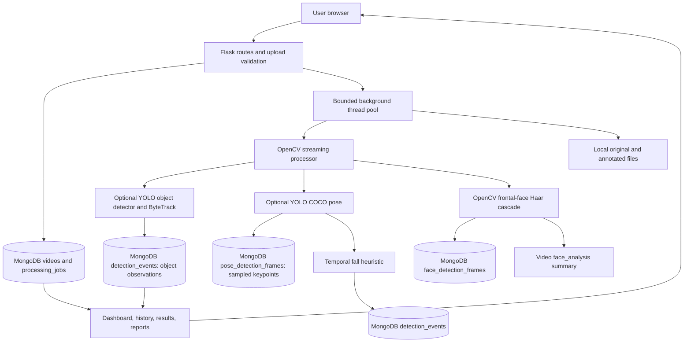
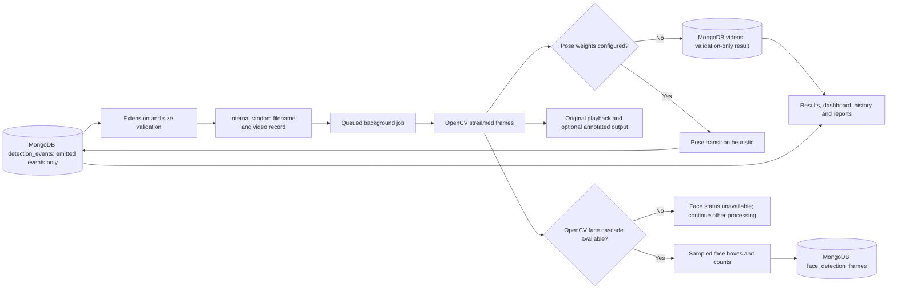

# Project Report: Web-Based Human Anomaly Detection System

> College report scaffold. Replace bracketed prompts with work you have actually performed. Do not invent evaluation values, screenshots, citations, or dataset outcomes.

## Abstract

This project presents a browser-based Flask application for local video analysis. It stores metadata/jobs/events in MongoDB, keeps videos on local storage, and runs work in a bounded background thread pool. OpenCV face detection is available independently. Optional Ultralytics object detection and tracking require a locally configured model. Optional YOLO pose weights support a documented temporal heuristic for potential fall transitions. These research prototypes have no validated accuracy claim.

## Introduction

Describe the context of human activity analysis, the motivation for a local educational prototype, and the importance of communicating model limits. Add only verified background sources.

## Existing and proposed systems

Describe relevant verified research and systems here. The proposed prototype provides upload validation and traceable local records, with an optional pose-based transition heuristic for one narrowly defined activity. Do not characterize it as a validated fall-recognition product.

## Problem statement

Create a beginner-accessible web workflow for handling video-analysis experiments and preserving their technical outcomes without presenting unsupported AI claims.

## Objectives

- Build a responsive Flask dashboard and upload workflow.
- Validate video readability and extract metadata using OpenCV.
- Optionally estimate COCO pose keypoints and apply an explainable fall-transition heuristic.
- Run long video analysis jobs in a bounded background queue and report progress.
- Persist video records and event rows in MongoDB.
- Detect frontal faces independently with OpenCV's bundled Haar cascade and save sampled-frame counts.
- Optionally detect supported COCO objects and temporarily track detected people, persisting actual sampled observations separately from anomaly events.
- Provide a deterministic summary and CSV report based only on persisted analysis results.
- Provide searchable history and data-backed CSV reports.
- Clearly document capabilities, limitations, privacy, and future model validation needs.

## Literature review

Add a small set of verified papers or official model documentation. For each: record authors, title, publication venue/year, DOI or stable URL, dataset, method, and limitations. Read the original source. Do not copy claims from search snippets.

## System requirements

**Software:** Python 3.10+, Flask, OpenCV, NumPy, MongoDB, modern browser, VS Code (recommended).

**Hardware:** A laptop that can run Python and decode short videos. Validation-only mode does not require a GPU. Optional pose inference requires the configured Ultralytics/PyTorch package and weights; CPU or supported CUDA hardware can be selected through PyTorch installation. Disk capacity must accommodate source and annotated files.

## Feasibility study

**Technical:** feasible as a local Flask/OpenCV application. Codec support varies. **Economic:** uses freely available open-source packages; verify licenses for future models. **Operational:** suitable for a classroom demonstration with consented, non-sensitive footage.

## Architecture

## Data flow diagram

## Database design

The `videos` collection stores filename, generated local-file reference, upload date, file size, status, duration, FPS, dimensions, processing time, error, and a separate `face_analysis` status/summary. `processing_jobs` holds `queued`, `processing`, `completed`, and `failed` states, progress and timestamps; active jobs from a prior local restart are marked interrupted. `detection_events` references a video ObjectId and stores anomaly category, video timestamp, nullable confidence, optional heuristic score, method and evidence metadata. Events are inserted only when the configured anomaly detector emits one. Non-object candidate events carry incident review status and notes in the same document to avoid duplicate incident records. `face_detection_frames` separately stores sampled video timestamps, face counts, and bounding boxes; it does not identify people or contain confidence scores.
`detection_events` also holds actual sampled object observations with event type `object_detection`, supported class label, model confidence, frame/timestamp, bounding box, and optional temporary tracker ID. These observations are not anomaly claims and dashboard anomaly totals exclude this event type. Person track counts are approximate tracker outputs, not unique identities. The deterministic summary and CSV report are generated from stored records; no language model or invented content is used.
`pose_detection_frames` stores one bounded evidence document per sampled frame with detected person count and available COCO shoulders, hips, knees and ankles, including coordinates and keypoint confidence when supplied by the model. The UI retrieves a bounded, time-ordered set for review. Existing records without this collection remain compatible; the index is created on startup without dropping data.

## Module descriptions

- `app/routes`: page, upload, history, incident review, result and report endpoints.
- `app/services/video_processor.py`: bounded-frame OpenCV processing, metadata and optional annotated output.
- `app/services/fall_detector.py`: optional pose inference and upright/drop/persistence heuristic.
- `app/services/repository.py`: bounded MongoDB read/write helpers for face and pose sampled-frame evidence.
- `app/services/face_detector.py`: OpenCV's bundled frontal-face Haar cascade; no external model download is performed.
- `app/services/object_detector.py`: optional local Ultralytics detector with ByteTrack persistence; model files are not downloaded automatically.
- `app/services/report_service.py`: evidence-grounded structured summary and per-video CSV report.
- `app/services/pdf_report.py`: dependency-free PDF generation from persisted video, job, event and review data.
- `app/services/repository.py`: MongoDB data access and dashboard/report queries.
- `app/routes/videos.py`: upload and enqueue, worker lifecycle, result/media/status routes.
- `app/db.py`: MongoDB schema and connection helper.
- `app/routes/history.py`: video-library filtering, deletion, and conditional retry for failed/interrupted jobs.
- `app/templates` and `app/static`: Jinja pages, responsive styling and small interactions.

## Implementation

Explain the chosen local configuration, generated filenames, upload checks, database writes, and how actual dashboard values are queried. Include screenshots captured from your own running instance and describe the exact environment used.

## Testing and results

Workspace verification on 2026-10-23: `.venv\Scripts\python.exe -B -m pytest -q -p no:cacheprovider` completed with **41 passed**. Python AST parsing succeeded for 19 files, `node --check` succeeded for both JavaScript files, and `git diff --check` found no whitespace errors (Git reported line-ending normalization warnings only). Tests use isolated mongomock and synthetic/fake model outputs; they verify routes, validation, video decoding, persistence logic, pose keypoint evidence serialization, fall-transition intervals, object detection normalization, tracker aggregation, reports, retries, and error handling, but do not verify real Ultralytics inference. A separate actual-config upload check returned 200 for `GET /upload`; a valid diagnostic upload returned a handled 503 and its local file was cleaned up because Mongo client initialization failed with a sanitized `ConfigurationError` indicating DNS hostname resolution failure. The connection failed before the ping and no Atlas collection read/write could be performed. No pose/object weights or Ultralytics package are available in this workspace. No positive face-video sample is included, so positive face-detection quality is unverified.

Workspace verification on 2026-10-24: the full suite completed with **54 passed** after the job-state, timeline, incident-review and PDF changes. PDF reports are emitted by the standard-library implementation and require no added dependency. An application-configured Atlas startup/ping check in this environment failed before a client could be created: Python dnspython SRV DNS queries to the configured public resolvers timed out. Therefore live Atlas persistence was not verified in this session; mocked persistence and route behavior were tested.

## Limitations

The fall-transition heuristic has not been validated against a research dataset and is susceptible to missed events and false positives. It emits at most one event per video, and its pose association chooses the nearest detected pose center; it can switch people in crowded scenes and is not identity tracking. Object detector availability depends on separately installed Ultralytics/PyTorch and an explicitly configured compatible local weight file; object classes depend on those weights. ByteTrack IDs can change after missed detections/occlusions and do not identify people. Optional clip-level violence-related review is implemented with an X3D-M model trained on RWF-2000; it is not a fight subtype classifier, has no person or zone localization, and its performance on Sentinel footage is unverified. General anomaly detection remains unavailable. Annotated output depends on OpenCV codec support. Empty event counts do not imply normal activity.

## Conclusion and future scope

Summarize the working Mongo-backed video-management site, optional object observations/tracking, and experimental fall-transition prototype according to the features actually configured and tested. Future work should evaluate on consented labeled data, define event-level metrics, improve multi-person tracking, add account permissions, and use a durable external worker system before public deployment.

## References

Add only sources you verified directly. Optional model guides and licensing details are documented in README and docs/FIGHT_DETECTION.md. The X3D-M checkpoint card reports its own validation metrics; these have not been independently evaluated in Sentinel. Record the exact weight file/version you obtain and license terms reviewed. No dataset is bundled and no accuracy, dataset result or experiment is claimed.
Optional surveillance zones are stored as normalized polygons on the video record. The analysis pipeline associates only pose-based fall candidates that include a valid person bounding box, using that box's bottom-center pixel and OpenCV point-in-polygon testing. A missing pose model or missing event location is reported as unavailable; face and generic object detections are not treated as anomaly locations. Zone overlays are drawn only into a separate generated output file.

Restricted-area entry events are tracked separately from fall candidates. When an enabled zone is present, pose frames are sampled at the configured zone cadence (default 0.5 seconds). Per-zone, per-track state requires confirmed outside observations followed by consecutive clearly-inside observations; an 8-pixel boundary deadband reduces polygon-edge jitter, and a track gap beyond the configured limit resets state. First observed occupancy is informational only and does not establish an entry. IDs are temporary tracker associations; an entry event is a review signal, not proof of intent, identity, or wrongdoing. The method can miss crossings between sampled frames and has not been validated as a security system.
